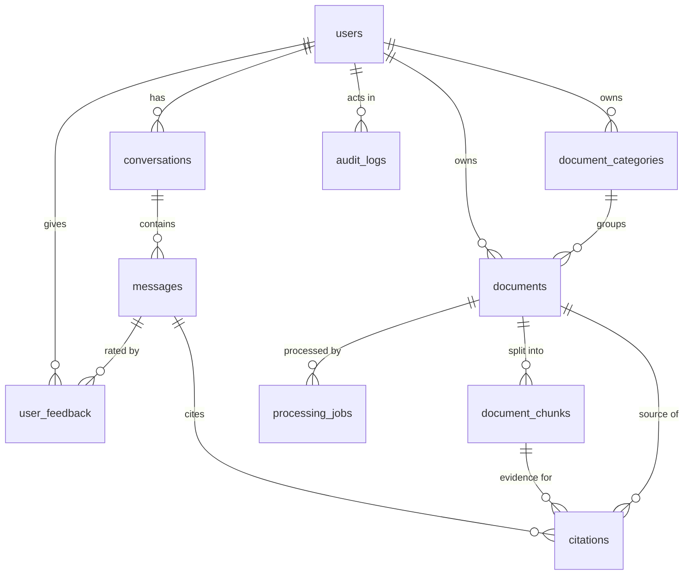

# Database design (PostgreSQL 16 + pgvector)

## Relationships and delete behaviour
- Deleting a **user** cascades to their documents, categories, conversations and feedback. `audit_logs.user_id` is set NULL so the audit trail survives.
- Deleting a **document** cascades to its chunks and processing jobs. `citations.document_id/chunk_id` are set NULL, and citations keep a snapshot (title, page, excerpt) so old answers stay readable.
- Deleting a **category** sets `documents.category_id` NULL. Deleting a **conversation** cascades to messages, citations and feedback.

## Key decisions
- UUID primary keys (not guessable); `audit_logs` uses a bigint serial (append-only, high volume).
- `document_chunks.embedding vector(384)` with an HNSW cosine index. The dimension is fixed per index (`EMBEDDING_DIM`); changing the embedding model means a migration plus re-embedding. The chunk `id` is the proposal's "embedding ID".
- `documents` is unique on `(owner_id, sha256)` to stop duplicate uploads. `source_type` covers pdf/docx/txt/csv/faq/web from the proposal.
- Enums are stored as VARCHAR + CHECK constraints (easier migrations than native enums).
- Access control: every document/conversation query must filter by `owner_id`/`user_id` unless the caller is an admin (enforced in the service layer from Phase 2).
